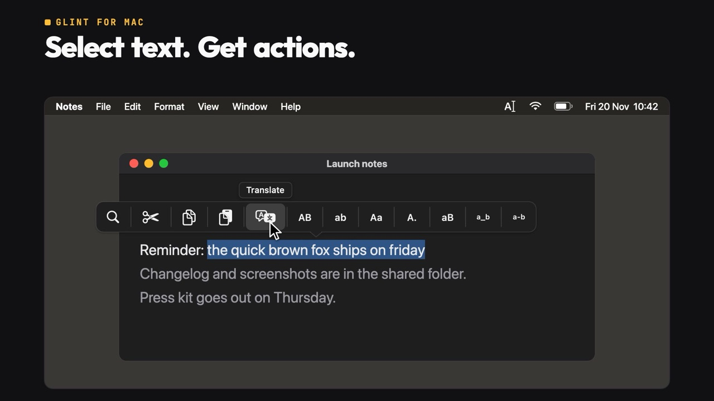
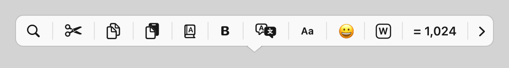

# Glint

Glint is a small, native macOS menu-bar app. Select text in any app and a floating bar of actions
appears just above the selection: search it, copy or paste over it, open the link in it, translate it,
change its case, format it as JSON, send it to Reminders, and more. You can add your own actions as
**extensions**: a few lines of YAML, a shell script, AppleScript or JavaScript.

- Native Swift/AppKit, macOS 14 Sonoma or later. Lives in the menu bar, with no Dock icon.
- Works in any app that exposes its selection through the Accessibility API, with a clipboard fallback for the rest.
- Extensions are plain folders or text snippets. Select a snippet anywhere and click **Install Extension**.
- Loads PopClip-format snippets and extensions too, so existing ones keep working (see [Compatibility](#compatibility)).

**Website:** [saibarathr.github.io/glint](https://saibarathr.github.io/glint/): download, install steps, demo,
[extension gallery](https://saibarathr.github.io/glint/extensions/) and the [docs](https://saibarathr.github.io/glint/docs/).

[](https://saibarathr.github.io/glint/#videos-title)

▶ Watch the [36-second promo](https://saibarathr.github.io/glint/media/promo.mp4) or the
[84-second walkthrough](https://saibarathr.github.io/glint/media/demo.mp4) (install, the built-in actions, adding an extension).

<sub>Promo music: "Wallpaper" by Kevin MacLeod (incompetech.com), licensed under
[Creative Commons: By Attribution 4.0](http://creativecommons.org/licenses/by/4.0/).</sub>



## Install a release

Download the latest `Glint-<version>-macos-universal.zip` and `SHA256SUMS.txt` from
[Releases](https://github.com/SaiBarathR/glint/releases), then check the archive:

```bash
shasum -a 256 -c SHA256SUMS.txt
```

Unzip it and move `Glint.app` to Applications. The app is ad-hoc signed rather than notarized, so
Gatekeeper blocks the first launch: open it once, dismiss the warning, then go to **System Settings →
Privacy & Security** and click **Open Anyway** next to the message about Glint. On macOS 14 you can
instead Control-click the app and choose **Open**.

Glint then asks for **Accessibility** access, which it needs to read the selection and paste results
(see [Granting Accessibility access](#granting-accessibility-access)). The app is universal
(`arm64` + `x86_64`) and needs macOS 14 or newer.

Glint checks GitHub for a newer release once a day and shows **Update Available** in its menu bar
menu. Turn this off in Settings → General.

## Features

### Built-in actions

| Action | What it does |
| --- | --- |
| **Search** | Search the web for the selection with your chosen search engine. |
| **Cut / Copy / Paste** | The usual, from the bar. Cut only appears in editable text. Hold ⇧ on Copy to append to the clipboard instead of replacing it. |
| **Paste and Match Style** | Paste plain text that takes on the surrounding style. Holding ⌥ on Paste does the same. |
| **Open Link(s)** | Open the URL(s) found in the selection. ⌘ opens in the background, ⇧ copies the link instead. |
| **New Email** | Start a message to a selected email address. |
| **Call** | Call a selected phone number (through a `tel:` link: FaceTime or your iPhone). |
| **Reveal in Finder** | Show a selected file path in Finder. |
| **Look Up** | Show the macOS dictionary definition. |
| **Spelling** | Suggestions for a misspelled word. Pick one to replace it. |
| **Bold / Italic / Underline** | Format rich text where the app supports it. |
| **Speak** | Read the selection aloud. |
| **Word Count** | Words, characters, lines and sentences. |
| **Calculate** | Evaluate a selected expression such as `12 * (3 + 4)` and paste or copy the result. |
| **Install Extension** | Appears when the selection is an extension snippet (text that starts with `#glint`). |

Every action can be switched on or off, reordered, and given its own global hotkey in Settings.

### Activation

- **Mouse selection**: drag-select, double-click (word), triple-click (line or paragraph) and shift-click to extend.
- **Long press** in an empty text field shows Paste.
- **Keyboard selection** (⇧ with the arrow keys, or ⌘A) can show the bar too (optional).
- **Suppress key**: hold a modifier of your choice while selecting to keep the bar hidden that time.
- **Global hotkey** to show the bar for the current selection on demand.
- **Per-action hotkeys** to run any action without opening the bar.
- **Excluded apps**: turn Glint off in the apps where you don't want it (password managers, games, remote desktops…).

### Appearance

Match the system, or always light or dark. Show icons, text, or both. Small, medium or large. Place the bar
above or below the selection. Optional labels on hover, and an option to hide the bar when the mouse moves
away. All of this is in **Settings → Appearance**.

### Modifier keys

Hold a modifier while clicking an action to change what it does:

| Key | Effect |
| --- | --- |
| ⇧ Shift | Copy the result instead of pasting it. For links and web searches, copy the URL instead of opening it. |
| ⌘ Command | Open URLs in the background, without bringing the browser to the front. |
| ⌥ Option | Use the action's alternate behaviour: the `alternate url` of a search, paste as plain text, descending sort in Sort Lines, and so on. |

## Bundled extensions

Glint ships with these extensions. **Translate** is on by default. Turn on the others
in **Settings → Actions**.

| Extension | Kind | What it does |
| --- | --- | --- |
| Translate | URL + option | Google Translate to a language you pick (English by default). |
| Change Case | JavaScript module | UPPERCASE, lowercase, Title Case, Sentence case, camelCase, snake_case, kebab-case. |
| Sort Lines | JavaScript module | Natural-order sort. ⌥ sorts descending. Options to remove duplicates and ignore case. |
| Whitespace | JavaScript + shell | Join wrapped lines into a paragraph, or trim and collapse stray whitespace. |
| Wrap | JavaScript | Wrap the selection in “quotes”, (parentheses), [brackets] or \`backticks\`. |
| Straight Quotes | JavaScript snippet | Turn curly quotes and primes into ASCII `'` and `"`. |
| URL Encode | JavaScript | Percent-encode, or decode percent-encoded text. |
| Base64 | Shell script files | Encode or decode Base64 (standard and URL-safe). |
| Format JSON | JavaScript module | Pretty-print (2 spaces, 4 spaces or tab, optional key sorting) or minify. Invalid JSON shows ✗. |
| Markdown Link | JavaScript | `Docs https://example.com` → `[Docs](https://example.com)`. |
| Plain Text | JavaScript | Copy without formatting, or strip HTML tags from selected markup. |
| Hash | Shell (JSON config) | SHA-256, SHA-1 or MD5 of the selection. |
| Character Codes | Perl snippet | Unicode code points of every character (`U+0041 U+00E9`). |
| Add to Reminders | AppleScript | New reminder in your default list. The first line becomes the title, the rest the notes. |
| New Note | AppleScript | Save the selection as a new note in Notes. |
| Open in Terminal | Shell | Open Terminal at a selected folder path. |
| Run Shortcut | Shell + option | Run a Shortcuts shortcut you name on the selection and show its output. |
| Wikipedia, YouTube, Maps, GitHub Search, Stack Overflow, Amazon, Dictionary, Ask Claude, Perplexity, X Search, Reddit Search | URL | Web searches. Maps, GitHub Search and X Search have an ⌥ alternate. |

Everything except the web searches works offline. The bundled extensions live in
[`App/Resources/Extensions`](App/Resources/Extensions) and double as examples of each extension format.

## Write your own extension

Select this text anywhere and click **Install Extension** in the bar:

```yaml
#glint
name: Shout
icon: symbol:megaphone
after: paste-result
shell script: tr '[:lower:]' '[:upper:]'
```

Or write the script first and put the config in its header comments:

```js
// #glint
// name: Reverse
// icon: symbol:arrow.left.arrow.right
// after: paste-result
return glint.input.text.split('').reverse().join('');
```

Larger extensions are folders named `Something.glintext` that hold a `Config.yaml` (or `.json`, `.plist`,
or a `Config.js` module) plus any script files. Drop the folder onto Glint or double-click it to install.
Installed extensions live in `~/Library/Application Support/Glint/Extensions`.

The full reference, covering every key, action kind, placeholder, environment variable, JavaScript API
call and requirement, is in **[docs/EXTENSIONS.md](docs/EXTENSIONS.md)**.

## Build from source

Needs Xcode (15 or later) and [XcodeGen](https://github.com/yonaskolb/XcodeGen):

```bash
brew install xcodegen
./scripts/build-app.sh --install
```

That builds `dist/Glint.app` as a universal binary, ad-hoc signs it, and copies it to `/Applications`.
Leave off `--install` to just build into `dist/`, add `--native` to skip the second architecture while
iterating, or `--dev-sign` to sign with the Apple Development identity in `project.yml` so macOS keeps
the Accessibility permission across rebuilds.

Run the engine's unit tests, which also load and exercise every bundled and gallery extension:

```bash
swift test --package-path Packages/GlintCore
```

Regenerate the app icon (drawn in code with CoreGraphics):

```bash
swift scripts/make-icon.swift
```

### Granting Accessibility access

Glint reads the selection and pastes results through the macOS Accessibility API, so it needs your permission:

1. Launch Glint. The onboarding window links straight to the right settings pane.
2. Open **System Settings → Privacy & Security → Accessibility** and switch **Glint** on.
3. **After updating** (or rebuilding or moving the app), macOS no longer recognises the new copy, because
   the permission is tied to the app's signature. Switch Glint off and on again; if the bar still doesn't
   appear, remove Glint from the list with **–** and add it again.

AppleScript extensions that control other apps (Reminders, Notes…) ask for **Automation** permission
the first time they run.

## Project layout

```
App/                      the macOS app (AppKit + SwiftUI settings)
  Resources/Extensions/   bundled extensions
Packages/GlintCore/       extension engine: config parsing, requirements, script/JS runners (with tests)
gallery/                  extra extensions offered on the website
site/                     the website (GitHub Pages)
scripts/                  build, release-check and icon scripts
docs/                     EXTENSIONS.md (extension reference), architecture, releasing, release notes
```

More: [docs/architecture.md](docs/architecture.md) · [docs/releasing.md](docs/releasing.md) ·
[CONTRIBUTING.md](CONTRIBUTING.md) · [AGENTS.md](AGENTS.md)

## Compatibility

Glint is an independent project. It is not affiliated with, endorsed by, or connected to PopClip or
Pilotmoon Software. For interoperability, Glint understands the PopClip extension config keys and
snippet format: `#popclip` snippet headers, `.popclipext` folders, `{popclip text}` placeholders,
`POPCLIP_*` environment variables and the `popclip.*` JavaScript API all work. Most existing
PopClip snippets and extensions run unchanged. Glint's own format, documented in
[docs/EXTENSIONS.md](docs/EXTENSIONS.md), uses `#glint`, `{glint text}`, `GLINT_*` and `glint.*`.

## License

[MIT](LICENSE) © 2026 Sai Barath
